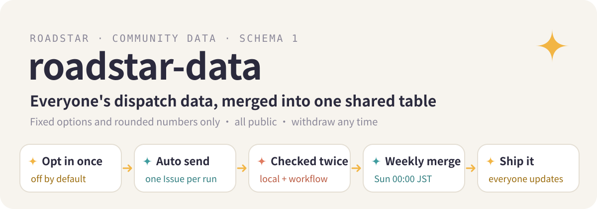

  

<a href="./README.md">中文</a> · <b>English</b> · <a href="./README.ja.md">日本語</a>

  
  
  
  

This repository collects the dispatch statistics that [Roadstar](https://github.com/Rurutia-Artemis/Roadstar) users choose to send. Once a week the data is merged to show which model handles which kind of task best. The maintainer reviews the result, updates Roadstar's routing table, and every user gets the improvement with the next version.

## What is sent

Each record has these fields and nothing else. Every value is a fixed option or a rounded number; there is no free-text field.

| Field | Meaning |
|---|---|
| `id` | First 16 hex characters of a hash of the local record, used only to remove duplicates |
| `week` | ISO week such as `2026-W42`; no exact time |
| `class` | Task class, one of 11 fixed words |
| `model`, `model_version`, `effort` | Model, version and reasoning effort |
| `outcome`, `done_ratio` | Whether the task finished and what share of its checks passed |
| `minutes` | Time spent, rounded to 5 minutes |
| `escalated` | Whether a stuck task was handed to a higher tier |
| `quota_delta` | Quota used, rounded |
| `plan` | Subscription tier |

Code, file names, paths, project names, task text, error messages and machine names are never sent. The full format is in [`schema/dispatch-v1.json`](schema/dispatch-v1.json).

## How data arrives

1. The first time Roadstar starts, it asks once whether to turn sending on. The default is off.
2. When it is on, each finished Roadstar run opens one Issue here through the user's own `gh`, titled `dispatch-data · schema 1 · <week>`. The Issue shows the user's GitHub name and is public.
3. Before sending, Roadstar checks the batch against the schema and keeps an exact copy on the user's machine.
4. The [validation workflow](.github/workflows/validate.yml) checks every Issue again. Valid ones get the `accepted` label. Invalid ones get `rejected`, a comment listing the reasons, and are closed.

To withdraw data, delete your Issue; the next merge leaves it out. To stop sending, say 「关掉回传」 (turn off sending) in Roadstar or set `ROADSTAR_TELEMETRY=0`.

## How data is merged

Every Sunday at 00:00 JST the [merge workflow](.github/workflows/aggregate.yml) reads all `accepted` Issues and writes two files:

- [`community-table.md`](community-table.md) for people
- [`community-table.json`](community-table.json) for Roadstar

Records are de-duplicated, each person counts for at most 50 records per week, and every group shows how many records it has and from how many people. A group needs at least 5 records from at least 3 people before it gets a suggestion. The output files contain no GitHub names.

The maintainer reads the table once a week, approves changes to Roadstar's routing table and ships a new version. All users share that one table and are told when an update is available.

## License

Code is MIT, see [LICENSE](LICENSE). Submitted data and the merged tables are released under [CC0 1.0](https://creativecommons.org/publicdomain/zero/1.0/).

Not affiliated with Anthropic or OpenAI.
