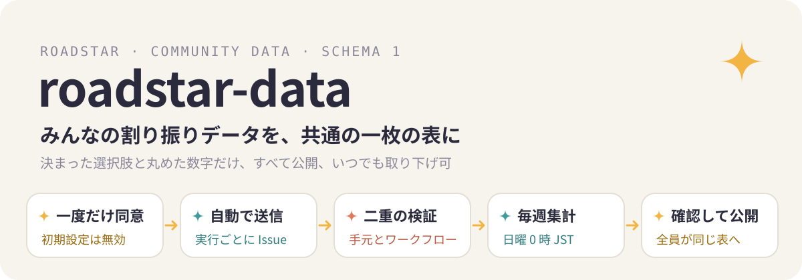

  

<a href="./README.md">中文</a> · <a href="./README.en.md">English</a> · <b>日本語</b>

  
  
  
  

このリポジトリは、[Roadstar](https://github.com/Rurutia-Artemis/Roadstar) の利用者が任意で送る割り振りの統計を受け取る場所です。毎週まとめて、どの種類の作業にどのモデルが合うかを出し、作者が確認したうえで Roadstar の割り振り表に反映します。更新すれば、使う人全員が同じ改善を受け取れます。

## 送られる内容

1 件の記録に入るのは次の項目だけです。値はすべて決まった選択肢か丸めた数字で、自由に文字を書ける項目はありません。

| 項目 | 内容 |
|---|---|
| `id` | 手元の記録のハッシュ先頭 16 文字。重複を除くためだけに使う |
| `week` | 週（例 `2026-W42`）。正確な時刻は残さない |
| `class` | 作業の種類。決まった 11 語のどれか |
| `model`、`model_version`、`effort` | モデル、バージョン、推論強度 |
| `outcome`、`done_ratio` | 終わったかどうか、検証項目が何割通ったか |
| `minutes` | かかった時間（5 分単位で丸め） |
| `escalated` | 行き詰まって上の層に回したか |
| `quota_delta` | 使った利用枠（丸め） |
| `plan` | 契約プラン |

コード、ファイル名、パス、プロジェクト名、作業の中身、エラー文、マシン名は送りません。形式の全体は [`schema/dispatch-v1.json`](schema/dispatch-v1.json) にあります。

## 届くまでの流れ

1. Roadstar を初めて使うとき、送信を有効にするかを一度だけ聞きます。初期設定は無効です。
2. 有効にすると、Roadstar の実行が終わるたびに、利用者自身の `gh` でここに Issue を 1 件作ります。題名は `dispatch-data · schema 1 · <週>` です。Issue には利用者の GitHub 名が付き、誰でも見られます。
3. 送る前に手元で形式を確かめ、送る内容をそのまま手元にも残します。
4. [検証ワークフロー](.github/workflows/validate.yml) が届いた Issue をもう一度確かめます。合格なら `accepted` を付け、不合格なら `rejected` を付けて理由をコメントし、閉じます。

取り下げたいときは自分の Issue を削除すれば、次の集計から外れます。送信を止めたいときは Roadstar で「关掉回传」（送信を止める）と言うか、環境変数 `ROADSTAR_TELEMETRY=0` を設定します。

## 集計の仕方

毎週日曜 0 時（日本時間）に [集計ワークフロー](.github/workflows/aggregate.yml) が `accepted` の Issue をすべて読み、次の二つを書き出します。

- [`community-table.md`](community-table.md)：人が読む表
- [`community-table.json`](community-table.json)：Roadstar が読む表

記録は重複を除き、一人あたり 1 週 50 件までしか数えません。どのグループにも記録数と、何人から集まったかを載せます。提案が出るのは、3 人以上から 5 件以上集まったグループだけです。書き出すファイルに GitHub 名は入りません。

作者は週に一度この表を見て、Roadstar の割り振り表の変更を決め、新しい版を出します。利用者全員が同じ表を使い、更新があれば最初に知らされます。

## ライセンス

コードは MIT（[LICENSE](LICENSE)）。送られたデータと集計表は [CC0 1.0](https://creativecommons.org/publicdomain/zero/1.0/) で権利を放棄しています。

Anthropic および OpenAI とは関係ありません。
