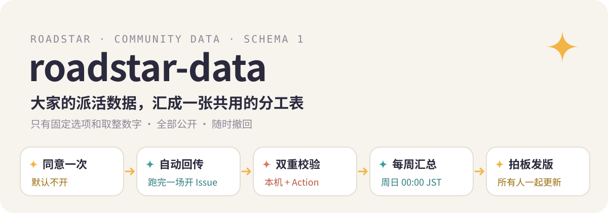

  

<b>中文</b> · <a href="./README.en.md">English</a> · <a href="./README.ja.md">日本語</a>

  
  
  
  

这个仓库只做一件事：收 [Roadstar](https://github.com/Rurutia-Artemis/Roadstar) 用户自愿回传的派活统计，每周汇总一次，算出「什么活交给什么型号最合适」，再由作者拍板写进 Roadstar 的分工表，所有人更新以后一起变好。

## 回传了什么

每条记录只有这些字段，全部是固定选项或取整后的数字，没有一个能自由填写文字的字段：

| 字段 | 内容 |
|---|---|
| `id` | 本地记录的哈希前 16 位，只用来去重 |
| `week` | 哪一周，例 `2026-W42`，不记具体时间 |
| `class` | 活的类别，11 个固定词之一（取证、批量、页面实现……） |
| `model`、`model_version`、`effort` | 型号、版本、强度 |
| `outcome`、`done_ratio` | 做没做完、过了几成检查项 |
| `minutes` | 用时，取到 5 分钟 |
| `escalated` | 有没有碰壁后交高一级补全 |
| `quota_delta` | 额度差，取整 |
| `plan` | 订阅档位 |

代码、文件名、路径、项目名、任务内容、报错文字、机器名都不传。完整格式在 [`schema/dispatch-v1.json`](schema/dispatch-v1.json)。

## 怎么进来的

1. 用户在 Roadstar 第一次开场时被问一次要不要开启回传，默认不开。
2. 开启后，每跑完一场派活，Roadstar 用用户本机的 `gh` 在这里开一条 Issue，标题是 `dispatch-data · schema 1 · <周>`。这条 Issue 带用户的 GitHub 用户名，所有人都看得到。
3. 发送前，用户本机已经按格式检查过一遍，并把这一批原样留了一份在本机。
4. Issue 进来后，[校验 Action](.github/workflows/validate.yml) 再查一遍：合格的打 `accepted` 标签，不合格的打 `rejected`、留言说明原因并关闭。

想撤回：删掉自己开的那条 Issue，下一次汇总就不再计入。想关掉回传：在 Roadstar 里说一句「关掉回传」，或设环境变量 `ROADSTAR_TELEMETRY=0`。

## 怎么汇总

每周日 00:00（日本时间），[汇总 Action](.github/workflows/aggregate.yml) 读所有 `accepted` 的 Issue，生成两份文件：

- [`community-table.md`](community-table.md)：给人看的表。
- [`community-table.json`](community-table.json)：给 Roadstar 读的表。

汇总时按记录去重；同一个人每周最多计 50 条；每一组都写明有多少条记录、来自多少个不同的人。一组至少 5 条记录、来自至少 3 个人，才给出「可作起步层」或「起步层该升」的建议。产出文件里没有任何 GitHub 用户名。

作者每周看一次这张表，拍板后改 Roadstar 的分工表、发新版本。所有用户共用同一张分工表，开场时会被提醒更新。

## 许可

代码 MIT，见 [LICENSE](LICENSE)。回传的数据和汇总表按 [CC0 1.0](https://creativecommons.org/publicdomain/zero/1.0/) 放弃权利，任何人都可以拿去用。

本仓库与 Anthropic、OpenAI 没有关联。
